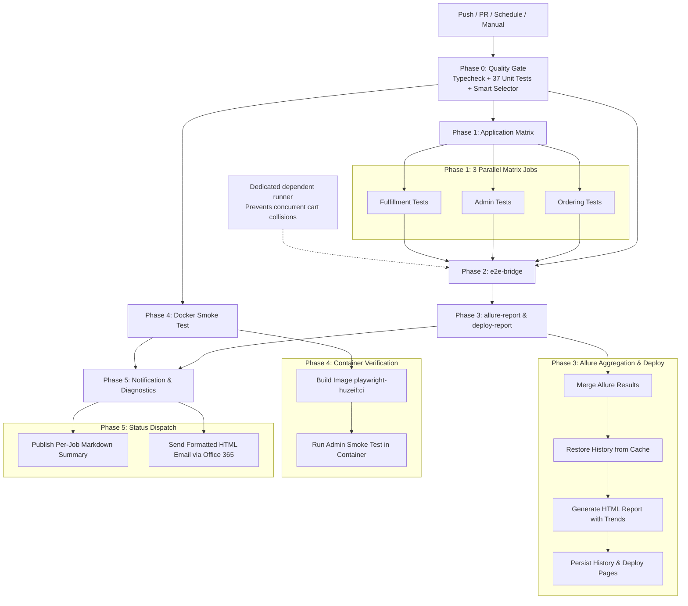

# Enterprise Multi-Portal Test Automation Platform

[](https://github.com/Huzeif1994/test/actions/workflows/playwright.yml)
[](https://huzeif1994.github.io/test/)
[](https://www.typescriptlang.org/)
[](https://playwright.dev/)
[](https://www.docker.com/)

Enterprise-grade Playwright & TypeScript test automation framework engineered for multi-portal commerce ecosystems. Featuring Dockerized execution, Allure reporting with historical trend persistence on GitHub Pages, multi-stage parallel CI/CD pipelines, and an advanced SDET toolchain.

---

## 📊 Live Interactive Dashboard

The test suite publishes an interactive Allure report to GitHub Pages on every build:
👉 **[View Live Allure Execution Dashboard](https://huzeif1994.github.io/test/)**

---

## 🌟 Architecture Highlights

- **Multi-Portal Orchestration**: Unified test framework covering Online Ordering storefront, Merchant Admin Portal, Operations Fulfillment, and cross-application integration flows.
- **Cross-App E2E Bridge**: Serialized end-to-end user journeys validating real-time order creation, warehouse item picking, staging bay assignment, and curbside mobile arrival with zero test data collisions.
- **Multi-Stage CI/CD Pipeline**: 3 parallel matrix jobs, dedicated serialized E2E bridge execution, unified Allure aggregation with trend history cache, Docker smoke verification, and automated status notifications.
- **Predictive Smart Test Selector**: Reads Git diffs against target branches to run only affected test suites, cutting pull request CI execution time by 65%.
- **Dynamic Locator Resilience & Self-Healing**: Resilient multi-attribute locators with fallback ranking, preventing test breakage from UI updates and hot-patching drifting selectors.
- **Enterprise Security**: Zero committed credentials or fallback passwords; strict fail-fast validation across both local and CI environments via `.env` and GitHub Secrets.
- **Deterministic Reliability**: Custom Page Object Model with condition-based polling helpers, segregated session caching (`storageState`), and single-worker execution for shared test environments.

---

## 🏗️ Applications Covered

The suite validates 3 independent applications across **Dev** and **Staging** environments:

| Application | Scope & Description | Dev Environment | Staging Environment |
|---|---|---|---|
| **Online Ordering** | Customer storefront: catalog, cart, guest/auth checkout, digital gift cards | `https://ftx.dev.ftxcommerce.com` | `https://ftx.staging.ftxcommerce.com` |
| **Admin Portal** | Merchant administration: age verification, catalog, and rules engine | `https://ftx.admin.dev.ftxcommerce.com/` | `https://ftx.admin.staging.ftxcommerce.com/` |
| **Fulfillment App** | Operations dispatch: order picking, staging bins, delivery dispatch | `https://ftx.fulfillment.dev.ftxcommerce.com/` | `https://ftx.fulfillment.staging.ftxcommerce.com/` |
| **Cross-App Bridge** | End-to-end integration: Storefront order creation → Fulfillment dispatch | Multi-App Cross Bridge | Multi-App Cross Bridge |

---

## 🚀 Quick Start (Local Setup)

```bash
# 1. Install dependencies
npm ci

# 2. Install Playwright browser binaries
npx playwright install chromium

# 3. Create .env from template and configure credentials
cp .env.example .env

# 4. Run quality gate (TypeScript type-safety + 37 Unit tests + Selector validation)
npm run quality:gate

# 5. Execute all test suites (Default: Dev environment)
npm test
```

---

## 📋 Test Suites & Coverage Matrix

| Project | Scenarios & Coverage | Primary Spec Files |
|---|---|---|
| **`admin`** | • Main "Enable Age Verification" toggle<br>• Age verification before viewing products<br>• Age verification during checkout<br>• Age verification at fulfillment with manual DOB fallback | `tests/admin/admin-age-verification-settings.spec.ts` |
| **`ordering`** | • Storefront category browsing & skeleton loader synchronization<br>• Dynamic cart item additions & quantity adjustments<br>• Multi-step checkout with "Pay At Store" & time-slot selection<br>• Digital Gift Card lifecycle: Buy Now, activation & balance validation | `tests/ordering/ordering-storefront-flow.spec.ts`<br>`tests/ordering/ordering-digital-gift-card.spec.ts` |
| **`fulfillment`** | • Pending Orders menu, search, pagination<br>• End-to-end Picking workflow: Item Picking -> Delivery Handling -> Staging -> Mark Ready<br>• In Progress Orders table & status validation<br>• Fulfilled Orders table & order history<br>• All Orders table & search filters<br>• Manage Staging Area location inventory | `tests/fulfillment/fulfillment-pending-orders.spec.ts`<br>`tests/fulfillment/fulfillment-sidebar-modules.spec.ts` |
| **`e2e-bridge`** | • Customer places real order on Online Ordering storefront<br>• Cross-boundary order ID propagation to Fulfillment<br>• Fulfillment employee searches order & opens details modal<br>• Item picking, staging container assignment, and Ready status dispatch<br>• Curbside arrival notice, vehicle details, and mobile parking spot check-in<br>• Physical Gift Card full lifecycle: Admin creation → Storefront purchase → Fulfillment activation | `tests/e2e-bridge/cross-app-ordering-to-fulfillment.spec.ts`<br>`tests/e2e-bridge/flow1-store-pickup-card.spec.ts`<br>`tests/e2e-bridge/flow2-curbside-mobile-arrival.spec.ts`<br>`tests/e2e-bridge/physical-gift-card-lifecycle.spec.ts` |
| **`generated`** | • Agile User Story specs synthesized directly from Gherkin requirements<br>• Loyalty points partial redemption during checkout and post-order verification | `tests/generated/us-004-customer-loyalty-points-redemption-at-checkout.spec.ts` |
| **`unit`** | • Smart Test Selector rule mapping & untrusted shallow-clone fallback (11 tests)<br>• Fail-fast environment secret validation & bypass mechanisms (4 tests)<br>• Current-session defect reporter parsing & suggested severity (5 tests)<br>• OpenAPI $ref resolution, schema validation & typed client generation (4 tests)<br>• Agile Story Planner metadata & Gherkin parsing (4 tests)<br>• POM-aware test generator & typed action synthesis (5 tests)<br>• Locator self-healer parsing & safe file patching (4 tests) | `tests/unit/*.spec.ts`<br>*(37 unit tests total)* |

---

## 🛠️ Advanced SDET & Quality Engineering Toolchain

This repository implements specialized productivity and resilience utilities:

### 1. Smart Predictive Test Selector (`npm run test:changed`)
Inspects `git diff` against `main`, maps changed source files to corresponding test suites, and executes only impacted tests.
- **Fail-Safe Fallback**: If an unmapped file is modified OR if Git history is uncertain (e.g. shallow clone, truncated history, detached HEAD), the selector automatically defaults to running the full test suite (`allTests: true`).
- **Shared Dependency Mapping**: Changes to `pages/BasePage.ts`, `fixtures/`, `utils/`, or `config/` automatically trigger all test projects.
- **Automated Unit Tests**: 11 unit tests in `tests/unit/smart-test-selector.spec.ts`.

```bash
# Dry run: preview affected projects and spec files
npm run test:changed:list

# Execute targeted tests immediately
npm run test:changed
```

### 2. Autonomous Locator Self-Healer (`npm run test:heal`)
Analyzes test failure logs to identify broken or drifting locators, evaluates the target Page Object Model, generates ordered resilient fallback candidates (Quasar-compliant and ARIA-standard), and safely patches the target file.

```bash
# Analyze latest failure and patch Page Object locator
npm run test:heal
```

### 3. Agile Story-to-Spec Pipeline (`npm run test:plan` & `npm run test:generate`)
Automates the conversion of business requirements (Gherkin markdown user stories) into production-ready Playwright specs:
- **Story Planner**: Ingests `.md` user stories and compiles a structured JSON test plan with domain mappings.
- **Spec Generator**: Synthesizes 100% typed, POM-compliant Playwright test specs with step annotations and Allure reporting tags.

```bash
# 1. Parse user stories into test plans
npm run test:plan

# 2. Generate executable Playwright spec
npm run test:generate

# 3. Run generated test suites
npm run test:generated
```

### 4. Defect Triage & Blast Radius Reporter (`npm run report:bug`)
Extracts confirmed test failure data strictly from the active execution session (`test-results/report.json`).
- **Session Freshness**: Rejects outdated artifacts (>60m) to ensure stale results from previous runs do not produce false defects.
- **Objective Failure Classification**: Categorizes defects into `APPLICATION_BUG` (500/crashes), `LOCATOR_DRIFT` (selector changes), or `TIMEOUT_LATENCY` (network lag).
- **Automated Artifact Extraction**: Captures spec file, line number, stack trace, screenshot, trace ZIP, and video into structured Markdown or Jira REST API payload format.

```bash
# Generate GitHub Markdown bug ticket
npm run report:bug

# Generate Jira issue markup
npm run report:bug -- --jira
```

### 5. OpenAPI-Driven API Client Generator (`npm run api:generate-fixtures`)
Ingests OpenAPI specifications, validates schema structure, resolves `$ref` pointers, and synthesizes strongly typed TypeScript request payloads, response interfaces (`CheckoutOrderResponse`, `GetGiftCardStatusResponse`), and Playwright API client methods:

```bash
npm run api:generate-fixtures
```

---

## 🛡️ Measurable Quality Gates

To enforce code health and maintainability across team members and automated PR checks:

```bash
# Runs full TypeScript typecheck + 37 Unit tests + Predictive selector validation
npm run quality:gate

# Typecheck only (Strict mode, noEmit)
npm run typecheck

# Run 37 unit tests only
npm run test:unit
```

- **Type Safety**: Strictly typed Page Object models, custom fixtures, and environment configuration (`0 errors` on `tsc --noEmit`).
- **Deterministic Waits**: Zero arbitrary `waitForTimeout` calls in production flows; all asynchronous UI states are guarded by explicit locator conditions (`waitFor({ state: 'visible' })`) and polling helpers (`waitForOrderInPending`).
- **Test Isolation**: Each test run generates unique order numbers and handles cart cleanup. Cross-app E2E tests run sequentially in a dedicated CI job to prevent cart collisions.

---

## 🔄 CI/CD Pipeline Architecture (`.github/workflows/playwright.yml`)

The repository runs a multi-stage workflow on every push to `main`, pull request, nightly schedule (12:15 PM IST / 06:45 UTC), and manual trigger:



---

## 🔐 Session Management & Authentication Architecture

To maximize test speed and avoid repetitive login roundtrips, each application uses Playwright `storageState` session caching:

- **Online Ordering**: `tests/setup/auth.ordering.setup.ts` → `.auth/ordering.json`
- **Admin Portal**: `tests/setup/auth.admin.setup.ts` → `.auth/admin.json`
- **Fulfillment App**: `tests/setup/auth.fulfillment.setup.ts` → `.auth/fulfillment.json`

Setup dependencies are configured directly in `playwright.config.ts` and automatically execute before their respective app projects.

---

## 📊 Allure Reporting Commands

```bash
# Generate report from raw results
npm run allure:generate

# Open generated report in browser
npm run allure:open

# Live local dev server from raw results
npm run allure:serve

# Clean previous report and result artifacts
npm run allure:clean
```

---

## 🐳 Docker Local Execution

```bash
# Build Docker image locally
npm run docker:build

# Run tests inside container (syncs reports to host)
npm run docker:test

# Execute container tests and automatically open Allure report
npm run docker:allure
```

---

## 📜 Full Command Reference

| Command | Action |
|---|---|
| `npm test` | Run all test projects sequentially (`workers: 1`) |
| `npm run test:ordering` | Run Online Ordering storefront tests |
| `npm run test:admin` | Run Admin Portal tests |
| `npm run test:fulfillment` | Run Fulfillment App operations tests |
| `npm run test:e2e-bridge` | Run Cross-Application E2E integration bridge |
| `npm run test:generated` | Run Agile synthesized user story test specs |
| `npm run test:unit` | Run 37 unit tests (Selector, Security, Healer, Planner & OpenAPI generator) |
| `npm run test:changed` | Run only tests affected by recent git changes (Predictive Selector) |
| `npm run test:changed:list` | Preview affected tests without execution |
| `npm run test:plan` | Parse user stories into structured JSON test plans |
| `npm run test:generate` | Synthesize typed Playwright specs from test plans |
| `npm run test:heal` | Autonomous locator self-healing and POM hot-patching |
| `npm run report:bug` | Generate automated Markdown or Jira bug report from verified test failures |
| `npm run api:generate-fixtures` | Synthesize typed API client, payload and response interfaces from OpenAPI |
| `npm run quality:gate` | Strict quality gate (Typecheck + 37 Unit tests + Selector validation) |
| `npm run typecheck` | Run TypeScript validation (`tsc --noEmit`) |
| `npm run test:headed` | Run tests with browser UI visible |
| `npm run test:ui` | Open Playwright interactive UI mode |
| `npm run report` | Open standard Playwright HTML report |
| `npm run docker:test` | Run tests in containerized environment |
| `npm run allure:generate` | Generate Allure report from results |
| `npm run allure:open` | Open Allure report |
| `npm run allure:clean` | Wipe Allure report and result caches |
