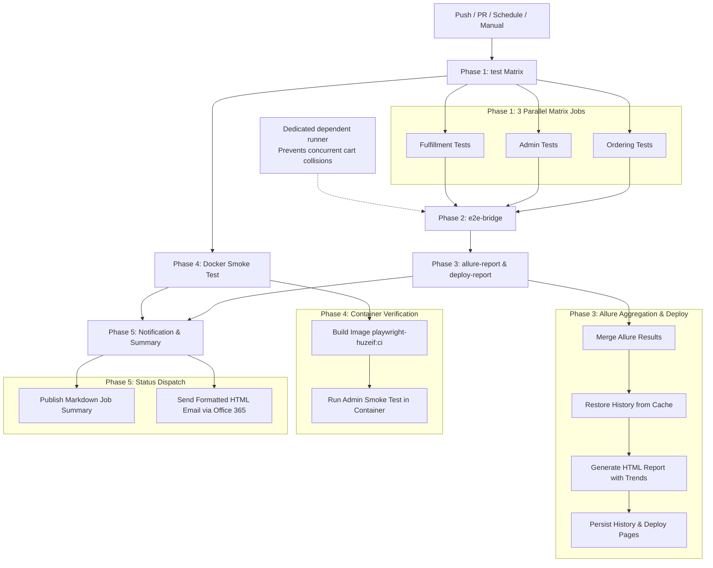

# playwright-huzeif

Enterprise-grade Playwright & TypeScript test automation framework engineered for multi-application commerce ecosystems. Featuring Dockerized execution, Allure reporting with historical trend persistence, 5-phase CI/CD pipelines, and an autonomous AI-native SDET toolchain.

---

## 🌟 Architecture Highlights

- **Multi-Application Orchestration**: Unified test framework covering Online Ordering storefront, Merchant Admin Portal, Operations Fulfillment, and cross-application integration flows.
- **5-Phase CI/CD Pipeline**: 3 parallel matrix jobs, dedicated serialized E2E bridge execution (eliminating shared-cart race conditions), unified Allure aggregation with trend history cache, Docker smoke verification, and Office 365 SMTP notifications.
- **AI-Native SDET Toolchain**: Built-in predictive test execution with fail-safe fallback, automated zero-touch bug reporting from verified session metadata, OpenAPI typed client generator with response interfaces, and machine-readable agent onboarding context.
- **Enterprise Security**: Zero committed credentials or fallback passwords; strict fail-fast validation across both local and CI environments via `.env` and GitHub Secrets.
- **Deterministic Reliability**: Custom Page Object Model with condition-based polling helpers, segregated session caching (`storageState`), and single-worker execution for shared test environments.

---

## 🏗️ Applications Covered

The suite validates 3 independent applications across **Dev** and **Staging** environments:

| Application | Scope & Description | Dev Environment | Staging Environment |
|---|---|---|---|
| **Online Ordering** | Customer storefront: catalog, cart, guest/auth checkout, gift cards | `https://ftx.dev.ftxcommerce.com` | `https://ftx.staging.ftxcommerce.com` |
| **Admin Portal** | Merchant administration: age verification, catalog, and rules engine | `https://ftx.admin.dev.ftxcommerce.com/` | `https://ftx.admin.staging.ftxcommerce.com/` |
| **Fulfillment App** | Operations dispatch: order picking, staging bins, delivery dispatch | `https://ftx.fulfillment.dev.ftxcommerce.com/` | `https://ftx.fulfillment.staging.ftxcommerce.com/` |
| **Cross-App Bridge** | End-to-end integration: Storefront order creation → Fulfillment dispatch | Multi-App Cross Bridge | Multi-App Cross Bridge |

---

## 🚀 Quick Start (Local Setup)

> **Important**: Open the `playwright-huzeif` directory directly as your workspace root in VS Code.

```bash
# 1. Install dependencies
npm ci

# 2. Install Playwright browser binaries
npx playwright install chromium

# 3. Create .env from template and configure credentials
cp .env.example .env

# 4. Run quality gate (TypeScript type-safety + 24 Unit tests + Selector validation)
npm run quality:gate

# 5. Execute all test suites (Default: Dev environment)
npm test
```

---

## 📋 Test Suites & Coverage Matrix

| Project | Scenarios & Coverage | Primary Spec Files |
|---|---|---|
| **`admin`** | • Scenario 1: Main "Enable Age Verification" toggle<br>• Scenario 2: Age verification before viewing products<br>• Scenario 3: Age verification during checkout<br>• Scenarios 4 & 5: Age verification at fulfillment with manual DOB fallback | `tests/admin/admin-age-verification-settings.spec.ts` |
| **`ordering`** | • Storefront category browsing & skeleton loader synchronization<br>• Dynamic cart item additions & quantity adjustments<br>• Multi-step checkout with "Pay At Store" & time-slot selection<br>• Legal compliance authorization toggle & order placement | `tests/ordering/ordering-storefront-flow.spec.ts` |
| **`fulfillment`** | • Pending Orders 5-action menu, search, pagination<br>• End-to-end Picking workflow: Item Picking -> Delivery Handling -> Staging -> Mark Ready<br>• In Progress Orders table & status validation<br>• Fulfilled Orders table & order history<br>• All Orders table & search filters<br>• Manage Staging Area location inventory | `tests/fulfillment/fulfillment-pending-orders.spec.ts`<br>`tests/fulfillment/fulfillment-sidebar-modules.spec.ts` |
| **`e2e-bridge`** | • Customer places real order on Online Ordering storefront<br>• Cross-boundary order ID propagation to Fulfillment<br>• Fulfillment employee searches order & opens details modal<br>• Item picking, staging container assignment, and Ready status dispatch<br>• Curbside arrival notice, vehicle details, and parking spot check-in<br>• Physical Gift Card full lifecycle: Admin creation → Storefront purchase → Fulfillment activation | `tests/e2e-bridge/cross-app-ordering-to-fulfillment.spec.ts`<br>`tests/e2e-bridge/flow1-store-pickup-card.spec.ts`<br>`tests/e2e-bridge/flow2-curbside-mobile-arrival.spec.ts`<br>`tests/e2e-bridge/physical-gift-card-lifecycle.spec.ts` |
| **`unit`** | • Smart Test Selector rule mapping & untrusted shallow-clone fallback (11 tests)<br>• Fail-fast environment secret validation & bypass mechanisms (4 tests)<br>• Current-session defect reporter parsing & suggested severity (5 tests)<br>• OpenAPI $ref resolution, schema validation & typed client generation (4 tests) | `tests/unit/smart-test-selector.spec.ts`<br>`tests/unit/environment-security.spec.ts`<br>`tests/unit/bug-reporter.spec.ts`<br>`tests/unit/api-fixture-generator.spec.ts` |

---

## 🤖 AI-Native SDET Toolchain

This repository implements autonomous SDET tools designed for pair programming with autonomous AI agents:

### 1. Universal AI Onboarding (`AGENT_CONTEXT.md`)
A comprehensive, machine-readable repository map providing AI agents with locator strategies, test fixtures, retry policies, environment mappings, and automated troubleshooting runbooks.

### 2. Smart Predictive Test Selector (`npm run test:changed`)
Inspects `git diff` against `main`, maps changed source files to corresponding test suites, and executes only impacted tests.
- **Fail-Safe Fallback**: If an unmapped file is modified OR if Git history is uncertain (e.g. shallow clone, truncated history, detached HEAD), the selector automatically defaults to running the full test suite (`allTests: true`).
- **Shared Dependency Mapping**: Changes to `pages/BasePage.ts`, `fixtures/`, `utils/`, or `config/` automatically trigger all test projects.
- **Automated Unit Tests**: 11 unit tests in `tests/unit/smart-test-selector.spec.ts`.

```bash
# Dry run: preview affected projects and spec files
npm run test:changed:list

# Execute targeted tests immediately
npm run test:changed
```

### 3. Current-Session Defect Reporter (`npm run report:bug`)
Extracts confirmed test failure data strictly from the active execution session (`test-results/report.json`).
- **Session Freshness & Zero Stale Artifacts**: Rejects outdated artifacts (>60m) to ensure stale results from previous runs do not produce false defects.
- **Dynamic Suggested Severity**: Labels severity objectively as `Suggested / Untriaged` (High for crash/500, Medium for locator/timeout, Low for environmental).
- **Zero False-Positives**: If all tests pass, reports clean execution and avoids generating fabricated defects.
- **Automated Artifact Extraction**: Captures real spec file, line number, stack trace, screenshot, trace ZIP, and video into structured GitHub Markdown or Jira format.

```bash
# Generate GitHub Markdown bug ticket
npm run report:bug

# Generate Jira issue markup
npm run report:bug -- --jira
```

### 4. OpenAPI-Driven API Client Generator (`npm run api:generate-fixtures`)
Ingests OpenAPI specifications, validates schema structure, resolves `$ref` pointers, and synthesizes strongly typed TypeScript request payloads, response interfaces (`CheckoutOrderResponse`, `GetGiftCardStatusResponse`), and Playwright API client methods:

```bash
npm run api:generate-fixtures
```

---

## 🛡️ Measurable Quality Gates

To enforce code health and maintainability across team members and automated PR checks:

```bash
# Runs full TypeScript typecheck + 24 Unit tests + Predictive selector validation
npm run quality:gate

# Typecheck only (Strict mode, noEmit)
npm run typecheck

# Run 24 unit tests only
npm run test:unit
```

- **Type Safety**: Strictly typed Page Object models, custom fixtures, and environment configuration (`0 errors` on `tsc --noEmit`).
- **Deterministic Waits**: Zero arbitrary `waitForTimeout` calls in production flows; all asynchronous UI states are guarded by explicit locator conditions (`waitFor({ state: 'visible' })`) and polling helpers (`waitForOrderInPending`).
- **Test Isolation**: Each test run generates unique order numbers and handles cart cleanup. Cross-app E2E tests run sequentially in a dedicated CI job to prevent cart collisions.

---

## 🔒 Test Data Hygiene & Report Privacy

1. **Synthetic & Anonymized Test Data**:
   - All test orders are generated dynamically with timestamped identifiers (e.g., `ORD-${Date.now()}`).
   - Accounts use synthetic test personas (`Test User`).
   - No production customer records, real credit cards, or personally identifiable information (PII) are ever accessed, stored, or transmitted.

2. **Report Privacy & Public Hosting**:
   - Allure reports deployed to GitHub Pages display only sanitized application UI screenshots, synthesized order numbers, and framework execution metrics.
   - For private or regulated enterprise environments, GitHub Pages access can be scoped to internal organization members via GitHub Enterprise repository settings.

3. **Zero Secrets in Code (Fail-Fast Enforcement Across Local & CI)**:
   - `config/environment.ts` reads credentials strictly from environment variables without hardcoded fallback strings.
   - Enforces a strict fail-fast check: in local test runs or CI, missing credentials throw an immediate `[Security Gate]` error.
   - Explicit dry-run bypass available via `SKIP_CREDENTIAL_CHECK=true` for linting and unit tests.

---

## 🔄 CI/CD Pipeline Architecture (`.github/workflows/playwright.yml`)

The repository runs a robust **5-phase workflow** on every push to `main`, pull request, nightly schedule (12:15 PM IST / 06:45 UTC), and manual trigger:



### Detailed Pipeline Phases

1. **Phase 1: `test` Matrix (3 Parallel Jobs)**:
   - Matrix runs `ordering`, `admin`, and `fulfillment` in parallel on `ubuntu-24.04`.
   - Enforces pre-execution Quality Gate (`npm run quality:gate`: strict typecheck + 24 unit tests + selector validation).
   - Uploads scoped artifacts: `playwright-report-<project>` and `allure-results-<project>`.

2. **Phase 2: `e2e-bridge` (Dedicated Sequential Runner)**:
   - Configured with `needs: test` to execute **after** standalone storefront tests finish.
   - Guarantees zero cart conflicts on the shared test user account between standalone storefront tests and cross-app E2E journeys.

3. **Phase 3: `allure-report` & `deploy-report` (Trend History Lifecycle)**:
   - Downloads and combines all `allure-results-*` artifacts from all projects.
   - Restores previous history from GitHub Actions cache (`allure-history`) into `allure-results/history`.
   - Generates unified Allure report with historical trend charts.
   - Preserves updated `allure-report/history` back into cache for subsequent runs.
   - Automatically publishes report to GitHub Pages on non-PR runs (`https://<username>.github.io/<repo>/`).

4. **Phase 4: `docker` Container Smoke Verification**:
   - Multi-stage Docker build utilizing GitHub Actions cache (`cache-from: type=gha`).
   - Executes containerized smoke verification (`--project=admin`) inside an isolated Linux container with host IPC optimization (`--ipc=host`) to validate container runtime integrity.

5. **Phase 5: `notify` Status Dispatch**:
   - Evaluates composite status across all jobs (`test`, `e2e-bridge`, `docker`).
   - Generates a styled Markdown Job Summary directly in the GitHub Actions run.
   - Dispatches formatted HTML execution alerts to team inboxes via Microsoft 365 / Outlook SMTP.

---

## 🔐 Session Management & Authentication Architecture

To maximize test speed and avoid repetitive login roundtrips, each application uses Playwright `storageState` session caching:

- **Online Ordering**: `tests/setup/auth.ordering.setup.ts` → `.auth/ordering.json`
- **Admin Portal**: `tests/setup/auth.admin.setup.ts` → `.auth/admin.json`
- **Fulfillment App**: `tests/setup/auth.fulfillment.setup.ts` → `.auth/fulfillment.json`

Setup dependencies are configured directly in `playwright.config.ts` and automatically execute before their respective app projects.

---

## ⚙️ Environment Configuration

Switch between environments via the `TEST_ENV` environment variable or `.env`:

```bash
# Run against Staging
TEST_ENV=staging npx playwright test

# Run Admin on Staging
TEST_ENV=staging npm run test:admin

# Run on Dev (Default)
TEST_ENV=dev npm test
```

### GitHub Secrets Configuration

For CI/CD execution, configure the following secrets under **Repository Settings → Secrets and variables → Actions**:

| Secret Name | Description |
|---|---|
| `ORDERING_DEV_USER` / `ORDERING_DEV_PASSWORD` | Storefront customer test credentials (Dev) |
| `ADMIN_DEV_USER` / `ADMIN_DEV_PASSWORD` | Merchant admin portal credentials (Dev) |
| `FULFILLMENT_DEV_USER` / `FULFILLMENT_DEV_PASSWORD` | Fulfillment team credentials (Dev) |
| `ORDERING_STAGING_USER` / `ORDERING_STAGING_PASSWORD` | Storefront customer credentials (Staging) |
| `ADMIN_STAGING_USER` / `ADMIN_STAGING_PASSWORD` | Merchant admin credentials (Staging) |
| `FULFILLMENT_STAGING_USER` / `FULFILLMENT_STAGING_PASSWORD` | Fulfillment team credentials (Staging) |
| `MAIL_USERNAME` / `MAIL_PASSWORD` | Office 365 / Outlook SMTP notification credentials |

---

## 📊 Allure Reporting Commands

```bash
# Generate report from raw results
npm run allure:generate

# Open generated report in browser
npm run allure:open

# Live local dev server from raw results
npm run allure:serve

# Clean previous report and result artifacts
npm run allure:clean
```

---

## 🐳 Docker Local Execution

```bash
# Build Docker image locally
npm run docker:build

# Run tests inside container (syncs reports to host)
npm run docker:test

# Execute container tests and automatically open Allure report
npm run docker:allure
```

---

## 📜 Full Command Reference

| Command | Action |
|---|---|
| `npm test` | Run all test projects sequentially (`workers: 1`) |
| `npm run test:ordering` | Run Online Ordering storefront tests |
| `npm run test:admin` | Run Admin Portal tests |
| `npm run test:fulfillment` | Run Fulfillment App operations tests |
| `npm run test:e2e-bridge` | Run Cross-Application E2E integration bridge |
| `npm run test:unit` | Run 24 unit tests (Selector, Security, Bug Reporter & OpenAPI generator) |
| `npm run test:changed` | Run only tests affected by recent git changes (Predictive SDET) |
| `npm run test:changed:list` | Preview affected tests without execution |
| `npm run report:bug` | Generate automated Markdown bug report from verified test failures |
| `npm run api:generate-fixtures` | Synthesize typed API client, payload and response interfaces from OpenAPI |
| `npm run quality:gate` | Strict quality gate (Typecheck + 24 Unit tests + Selector validation) |
| `npm run typecheck` | Run TypeScript validation (`tsc --noEmit`) |
| `npm run test:headed` | Run tests with browser UI visible |
| `npm run test:ui` | Open Playwright interactive UI mode |
| `npm run report` | Open standard Playwright HTML report |
| `npm run docker:test` | Run tests in containerized environment |
| `npm run allure:generate` | Generate Allure report from results |
| `npm run allure:open` | Open Allure report |
| `npm run allure:clean` | Wipe Allure report and result caches |
